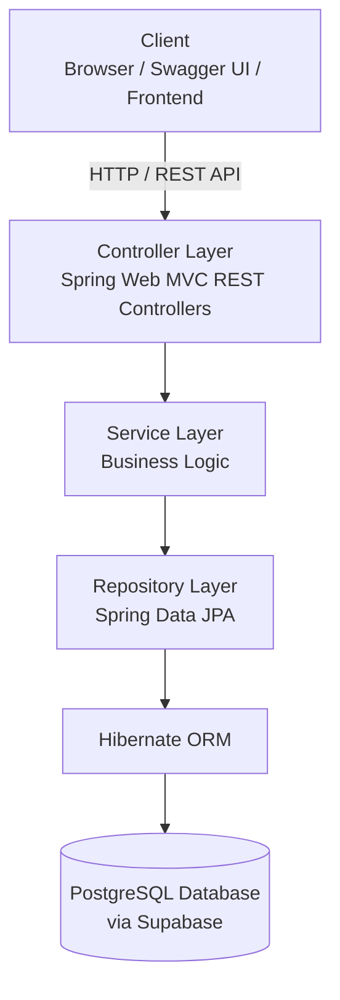
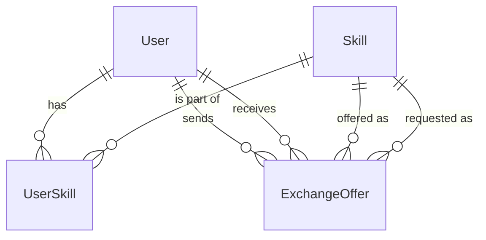
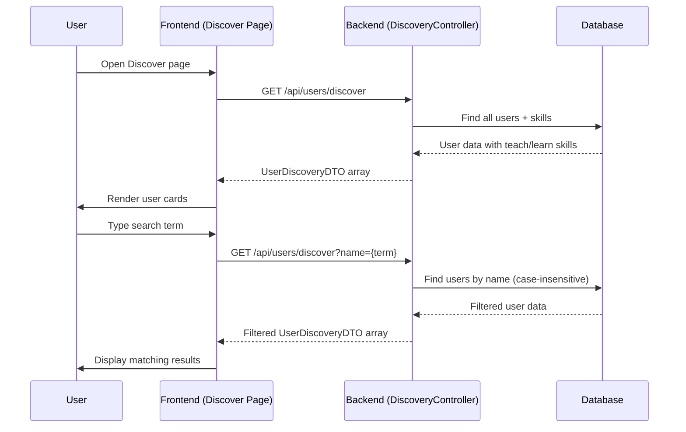

# SkillSwap – Peer-to-Peer Skill Exchange Platform

SkillSwap is a peer-to-peer skill exchange platform developed as a college OOP project.

The platform lets users register, log in, list skills they can teach and skills they want to learn, discover other users, and explore potential skill exchanges. A user who knows Java and wants to learn React can discover another user who knows React and wants to learn Java, then initiate a skill exchange.

The backend is a Spring Boot REST API backed by PostgreSQL (via Supabase). The frontend is a React + Vite application with Tailwind CSS styling. The frontend consumes backend REST APIs using the native `fetch` API.

This is an **academic project and local prototype**. It is not a production-grade enterprise application, and it does not use AI, machine learning, or complex recommendation algorithms.

---

## Table of Contents

- [Project Overview](#project-overview)
- [Key Features](#key-features)
- [Technology Stack](#technology-stack)
- [System Architecture](#system-architecture)
- [Database Design](#database-design)
- [Backend API Documentation](#backend-api-documentation)
- [Discover Page Workflow](#discover-page-workflow)
- [Project Structure](#project-structure)
- [Local Development Setup](#local-development-setup)
- [Environment Variables](#environment-variables)
- [Deployment Status](#deployment-status)
- [Current Development Status](#current-development-status)
- [Future Enhancements](#future-enhancements)
- [Contributors](#contributors)
- [License](#license)

---

## Project Overview

SkillSwap addresses the problem of finding people to exchange skills with on a peer-to-peer basis. Instead of paid courses or formal training, the platform connects individuals who want to teach what they know with others who want to learn it.

### Core Workflow

1. A user registers and logs in.
2. The user adds skills they can teach (TEACH) and skills they want to learn (LEARN) to their profile.
3. The user browses other registered users through the Discover page.
4. Each user card shows teaching skills, learning skills, and a bio.
5. The user can initiate a skill exchange offer with another user.

This is a college OOP project focused on clean Java object-oriented design, layered backend architecture, and REST API implementation.

---

## Key Features

### Authentication

- User registration with BCrypt password hashing.
- User login with BCrypt password verification.
- Duplicate email validation and rejection during registration.
- Login error handling for invalid credentials.
- Frontend authentication persistence using `localStorage` (key: `skillswap_user`).
- Stateless credential verification — no JWT or server-side session token is issued.

### User Profile

- View user ID, name, email, and bio.
- Edit profile name and bio in the frontend.
- Separate teaching and learning skill sections.
- Add and remove teaching skills.
- Add and remove learning skills.
- Skills are stored through backend APIs and persist across sessions.

### Skill Management

- TEACH and LEARN skill types (via `SkillType` enum).
- Skill categories.
- `UserSkill` associations linking users to skills.
- Duplicate skill prevention within the same type.
- Individual skill removal via association ID.

### Discover Users

- Fetch registered users dynamically from the backend via `GET /api/users/discover`.
- Display actual user names, bios, teaching skills, and learning skills.
- Name-based search with partial and case-insensitive matching.
- Optional exclusion of the logged-in user.
- Loading, error, and empty states.
- No hardcoded user cards or fabricated match percentages/ratings.

### Exchange Offers

Backend API endpoints exist for exchange offers, but full frontend integration is not yet completed:

- `POST /api/offers` — Create a PENDING exchange offer.
- `GET /api/offers/incoming/{userId}` — Retrieve offers received by a user.
- `GET /api/offers/outgoing/{userId}` — Retrieve offers sent by a user.
- `PUT /api/offers/{offerId}/accept/{userId}` — Accept a PENDING offer.
- `PUT /api/offers/{offerId}/reject/{userId}` — Reject a PENDING offer.

The frontend Discover page includes a "Send Exchange Offer" button per user card. It is disabled for the logged-in user's own card. Real offer creation and management workflows are pending full frontend integration.

### Skill Rooms

A "Skill Rooms" navigation item exists in the sidebar, but the dedicated room functionality and backend APIs are **not yet implemented**. It is listed as a planned feature.

---

## Technology Stack

### Frontend

| Technology | Version | Purpose |
|------------|---------|---------|
| React | 18.3.1 | User interface library |
| Vite | 6.0.5 | Development server and build tool |
| JavaScript | ES6+ | Application language |
| Tailwind CSS | 3.4.16 | Utility-first CSS styling |
| lucide-react | 0.468.0 | Icon library |
| react-router-dom | 6.28.0 | Client-side routing |
| Fetch API | Native | HTTP client for backend API calls |

### Backend

| Technology | Version | Purpose |
|------------|---------|---------|
| Java | 25 | Application language |
| Spring Boot | 4.1.2 | Application framework |
| Spring Web MVC | 4.1.2 | REST controllers and HTTP handling |
| Spring Data JPA | 4.1.2 | Repository abstraction |
| Hibernate ORM | 4.1.2 | Object-relational mapping |
| springdoc-openapi | 3.2.0 | Swagger UI and OpenAPI documentation |
| spring-security-crypto | Managed by Spring Boot BOM | BCrypt password hashing |

### Database

| Technology | Version | Purpose |
|------------|---------|---------|
| PostgreSQL | 17 | Persistent data storage |
| Supabase | — | PostgreSQL hosting |

### Build Tool

| Technology | Version | Purpose |
|------------|---------|---------|
| Apache Maven | 3.9.x | Dependency and build management |

**Note:** The `spring-boot-starter-websocket` dependency is declared in `pom.xml`, but no WebSocket controllers or chat endpoints are implemented.

---

## System Architecture

The backend follows a layered Spring Boot architecture:



### Controller Layer

Receives HTTP requests, validates input, calls services, and returns `ResponseEntity` responses with appropriate HTTP status codes. Controllers do not contain business logic.

### Service Layer

Contains business logic such as checking for duplicate emails, hashing passwords, verifying credentials, managing skill associations, and processing exchange offers.

### Repository Layer

Spring Data JPA interfaces that extend `JpaRepository` and provide database access. Custom query methods are declared for lookups by email, user ID, and skill name/category.

### Model / Entity Layer

JPA entities annotated with `@Entity` that map to PostgreSQL tables. Fields are encapsulated with getters and setters.

### DTO Layer

Plain Java objects used to transfer request and response data between the client and the server. DTOs use Jakarta Bean Validation annotations (`@NotBlank`, `@Email`, `@Size`, `@NotNull`).

---

## Database Design

The database name is `skill-swap`. Hibernate is configured with `ddl-auto=update`, so tables are created automatically on application startup.

### Entity: User

Table: `users`

| Field | Type | Constraints | Description |
|-------|------|-------------|-------------|
| `id` | `Long` | `@Id`, auto-generated | Primary key |
| `name` | `String` | `nullable = false`, length 100 | User's display name |
| `email` | `String` | `nullable = false`, `unique = true`, length 255 | User's email address |
| `passwordHash` | `String` | `nullable = false`, length 255 | BCrypt-hashed password |
| `bio` | `String` | length 1000 | Optional user biography |

A unique constraint `uk_users_email` enforces unique email addresses.

### Entity: Skill

Table: `skills`

| Field | Type | Constraints | Description |
|-------|------|-------------|-------------|
| `id` | `Long` | `@Id`, auto-generated | Primary key |
| `name` | `String` | `nullable = false`, length 100 | Skill name (e.g. "Java") |
| `category` | `String` | length 100 | Skill category (e.g. "Programming") |

Skills are shared across users. The repository looks up existing skills by name and category (case-insensitive) before creating a new one.

### Entity: UserSkill

Table: `user_skills`

| Field | Type | Constraints | Description |
|-------|------|-------------|-------------|
| `id` | `Long` | `@Id`, auto-generated | Primary key |
| `user` | `User` | `@ManyToOne`, `nullable = false` | The user who owns this skill association |
| `skill` | `Skill` | `@ManyToOne`, `nullable = false` | The skill being associated |
| `type` | `SkillType` | `@Enumerated(STRING)`, `nullable = false` | `TEACH` or `LEARN` |

A unique constraint `uk_user_skill_type` prevents duplicate associations of the same user, skill, and type.

### Entity: ExchangeOffer

Table: `exchange_offers`

| Field | Type | Constraints | Description |
|-------|------|-------------|-------------|
| `id` | `Long` | `@Id`, auto-generated | Primary key |
| `sender` | `User` | `@ManyToOne`, `nullable = false` | User sending the offer |
| `receiver` | `User` | `@ManyToOne`, `nullable = false` | User receiving the offer |
| `offeredSkill` | `Skill` | `@ManyToOne`, `nullable = false` | Skill the sender offers to teach |
| `requestedSkill` | `Skill` | `@ManyToOne`, `nullable = false` | Skill the sender wants to learn |
| `status` | `OfferStatus` | `@Enumerated(STRING)`, `nullable = false`, default `PENDING` | Offer lifecycle status |
| `createdAt` | `LocalDateTime` | `nullable = false` | Timestamp when the offer was created |

### Entity Relationship Diagram



### Enum: SkillType

Values: `TEACH`, `LEARN`

Indicates whether a user can teach a skill or wants to learn it.

### Enum: OfferStatus

Values: `PENDING`, `ACCEPTED`, `REJECTED`

Represents the lifecycle state of an exchange offer.

---

## Backend API Documentation

All backend endpoints are under the base URL `http://localhost:8080`.

### Endpoint: GET /

| Property | Value |
|----------|-------|
| Method | `GET` |
| URL | `/` |
| Purpose | Health check to confirm the backend is running. |
| Response | Plain text: `SkillSwap Backend is running!` |
| Success Status | `200 OK` |

### Authentication

#### POST /api/auth/register

Registers a new user account. Password is hashed with BCrypt before storage.

**Request Body:**

```json
{
  "name": "Rohan",
  "email": "rohan@example.com",
  "password": "password123",
  "bio": "Android and AI developer"
}
```

**Success Response (`201 Created`):**

```json
{
  "success": true,
  "message": "Registration successful",
  "id": 1,
  "name": "Rohan",
  "email": "rohan@example.com",
  "bio": "Android and AI developer"
}
```

**Error Responses:**

| Status | Condition |
|--------|-----------|
| `400 Bad Request` | Validation error (missing name, invalid email, password shorter than 6 characters). |
| `409 Conflict` | Email already registered. |

#### POST /api/auth/login

Verifies user credentials against the stored BCrypt hash. This MVP verifies credentials but does **not** issue a persistent authentication token or establish a secured session.

**Request Body:**

```json
{
  "email": "rohan@example.com",
  "password": "password123"
}
```

**Success Response (`200 OK`):**

```json
{
  "success": true,
  "message": "Login successful",
  "id": 1,
  "name": "Rohan",
  "email": "rohan@example.com",
  "bio": "Android and AI developer"
}
```

**Error Responses:**

| Status | Condition |
|--------|-----------|
| `400 Bad Request` | Validation error (missing email, invalid email format, missing password). |
| `401 Unauthorized` | Invalid email or password. |

**Note:** The `passwordHash` field is never included in any API response.

### Skill Management

#### POST /api/users/{userId}/skills

Adds a skill to a user's profile. Reuses an existing `Skill` record when name and category match (case-insensitive). Prevents duplicate user-skill-type associations.

**Path Parameter:** `userId` (Long) — ID of the user

**Request Body:**

```json
{
  "name": "Java",
  "category": "Programming",
  "type": "TEACH"
}
```

`type` must be either `TEACH` or `LEARN`.

**Success Response (`201 Created`):**

Returns the created `UserSkill` object:

```json
{
  "id": 1,
  "user": { "id": 1, "name": "Rohan", ... },
  "skill": { "id": 1, "name": "Java", "category": "Programming" },
  "type": "TEACH"
}
```

**Error Responses:**

| Status | Condition |
|--------|-----------|
| `400 Bad Request` | Validation error (missing name, category, or type). |
| `404 Not Found` | User with the given `userId` does not exist. |
| `409 Conflict` | The user already has this skill with this type. |

#### GET /api/users/{userId}/skills

Retrieves all skills associated with a particular user.

**Path Parameter:** `userId` (Long) — ID of the user

**Success Response (`200 OK`):**

Returns a list of `UserSkill` objects:

```json
[
  {
    "id": 1,
    "user": { "id": 1, "name": "Rohan", ... },
    "skill": { "id": 1, "name": "Java", "category": "Programming" },
    "type": "TEACH"
  },
  {
    "id": 2,
    "user": { "id": 1, "name": "Rohan", ... },
    "skill": { "id": 2, "name": "React", "category": "Frontend" },
    "type": "LEARN"
  }
]
```

**Error Responses:**

| Status | Condition |
|--------|-----------|
| `404 Not Found` | User with the given `userId` does not exist. |

#### DELETE /api/users/{userId}/skills/{userSkillId}

Removes the association between a user and a skill. Does **not** delete the shared `Skill` record itself.

**Path Parameters:**

- `userId` (Long) — ID of the user
- `userSkillId` (Long) — ID of the `UserSkill` association

**Success Response (`204 No Content`):**

No response body.

**Error Responses:**

| Status | Condition |
|--------|-----------|
| `404 Not Found` | The skill association was not found for this user. |

### User Discovery

#### GET /api/users/discover

Retrieves registered users with their teaching and learning skills. Optionally excludes a user by ID.

**Query Parameters:**

| Parameter | Type | Required | Description |
|-----------|------|----------|-------------|
| `name` | String | No | Optional partial name to search users by (case-insensitive). |
| `excludeUserId` | Long | No | ID of the user to exclude from discovery results (e.g., the logged-in user). |

**Examples:**

```
GET /api/users/discover
GET /api/users/discover?name=Rohan
GET /api/users/discover?excludeUserId=1
GET /api/users/discover?name=Rohan&excludeUserId=1
```

**Success Response (`200 OK`):**

Returns a list of `UserDiscoveryDTO` objects:

```json
[
  {
    "id": 1,
    "name": "Rohan",
    "email": "rohan@example.com",
    "bio": "Android developer",
    "teachSkills": [
      { "name": "Kotlin", "category": "Programming" }
    ],
    "learnSkills": [
      { "name": "Spring Boot", "category": "Backend Development" }
    ]
  }
]
```

**Behavior:**

- If `name` is missing or blank, returns all discoverable users.
- If `name` is provided, searches user names using partial, case-insensitive matching.
- Leading/trailing whitespace in `name` is trimmed.
- The user specified by `excludeUserId` is excluded from results.
- If no users match, returns an empty array.
- `passwordHash` is never exposed in the response.

#### Exchange Offers

#### POST /api/offers

Creates a PENDING exchange offer from sender to receiver.

**Request Body:**

```json
{
  "senderId": 1,
  "receiverId": 2,
  "offeredSkillId": 1,
  "requestedSkillId": 2
}
```

**Success Response (`201 Created`):**

Returns an `ExchangeOfferResponse` object.

**Error Responses:**

| Status | Condition |
|--------|-----------|
| `400 Bad Request` | Validation error or business rule violation (e.g., self-offer, missing skill ownership). |
| `404 Not Found` | User or skill not found. |

#### GET /api/offers/incoming/{userId}

Retrieves all exchange offers received by the specified user.

**Success Response (`200 OK`):**

Returns a list of `ExchangeOfferResponse` objects.

**Error Responses:**

| Status | Condition |
|--------|-----------|
| `404 Not Found` | User not found. |

#### GET /api/offers/outgoing/{userId}

Retrieves all exchange offers sent by the specified user.

**Success Response (`200 OK`):**

Returns a list of `ExchangeOfferResponse` objects.

**Error Responses:**

| Status | Condition |
|--------|-----------|
| `404 Not Found` | User not found. |

#### PUT /api/offers/{offerId}/accept/{userId}

Accepts a PENDING exchange offer. Only the receiver can accept. Changes status to `ACCEPTED`.

**Path Parameters:**

- `offerId` (Long) — ID of the offer to accept
- `userId` (Long) — ID of the user accepting the offer (must be the receiver)

**Success Response (`200 OK`):**

Returns the updated `ExchangeOfferResponse` object.

**Error Responses:**

| Status | Condition |
|--------|-----------|
| `403 Forbidden` | Only the receiver can accept this offer. |
| `404 Not Found` | Offer not found. |
| `409 Conflict` | Offer is already processed. |

#### PUT /api/offers/{offerId}/reject/{userId}

Rejects a PENDING exchange offer. Only the receiver can reject. Changes status to `REJECTED`.

**Path Parameters:**

- `offerId` (Long) — ID of the offer to reject
- `userId` (Long) — ID of the user rejecting the offer (must be the receiver)

**Success Response (`200 OK`):**

Returns the updated `ExchangeOfferResponse` object.

**Error Responses:**

| Status | Condition |
|--------|-----------|
| `403 Forbidden` | Only the receiver can reject this offer. |
| `404 Not Found` | Offer not found. |
| `409 Conflict` | Offer is already processed. |

---

## Discover Page Workflow

The Discover page consumes the Discovery API as follows:

### Initial Loading

When the Discover page opens, it calls:

```
GET http://localhost:8080/api/users/discover
```

No query parameters are passed during the initial request. The endpoint returns all registered users.

### Name-Based Search

When the user types in the search input, the frontend calls:

```
GET http://localhost:8080/api/users/discover?name={searchTerm}
```

- Search is debounced (300ms) to avoid excessive requests.
- Search is partial and case-insensitive (handled by the backend).
- Leading/trailing whitespace is trimmed.
- Clearing the search input refetches all users without the `name` parameter.

### Response Mapping

The API response is mapped to Discover cards as follows:

| API Field | Card Display |
|-----------|-------------|
| `name` | User name (heading) |
| `bio` | User bio (description text) |
| `teachSkills[].name` | "Can teach:" tag |
| `teachSkills[].category` | Category shown in parentheses |
| `learnSkills[].name` | "Wants to learn:" tag |
| `learnSkills[].category` | Category shown in parentheses |
| `name` (first letters) | Auto-generated avatar initials |

### States

| State | Display |
|-------|---------|
| Loading | "Loading users..." indicator |
| Error | Error message with Retry button |
| Empty (no users) | "No users found." message |
| Empty (search no match) | "No users found matching your search." message |

### Workflow Diagram



---

## Project Structure

```
Skill-Swap/
├── backend/
│   ├── .mvn/wrapper/
│   ├── mvnw
│   ├── mvnw.cmd
│   ├── pom.xml
│   ├── HELP.md
│   ├── backend.iml (implicit)
│   ├── src/
│   │   ├── main/
│   │   │   ├── java/com/example/backend/
│   │   │   │   ├── BackendApplication.java
│   │   │   │   ├── config/
│   │   │   │   │   └── PasswordConfig.java
│   │   │   │   ├── controller/
│   │   │   │   │   ├── AuthController.java
│   │   │   │   │   ├── DiscoveryController.java
│   │   │   │   │   ├── ExchangeOfferController.java
│   │   │   │   │   ├── GlobalExceptionHandler.java
│   │   │   │   │   ├── SkillController.java
│   │   │   │   │   └── TestController.java
│   │   │   │   ├── dto/
│   │   │   │   │   ├── AddSkillRequest.java
│   │   │   │   │   ├── AuthResponse.java
│   │   │   │   │   ├── CreateOfferRequest.java
│   │   │   │   │   ├── ExchangeOfferResponse.java
│   │   │   │   │   ├── LoginRequest.java
│   │   │   │   │   ├── RegisterRequest.java
│   │   │   │   │   └── SkillDTO.java
│   │   │   │   │   └── UserDiscoveryDTO.java
│   │   │   │   ├── model/
│   │   │   │   │   ├── ExchangeOffer.java
│   │   │   │   │   ├── OfferStatus.java
│   │   │   │   │   ├── Skill.java
│   │   │   │   │   ├── SkillType.java
│   │   │   │   │   ├── User.java
│   │   │   │   │   └── UserSkill.java
│   │   │   │   ├── repository/
│   │   │   │   │   ├── SkillRepository.java
│   │   │   │   │   ├── UserRepository.java
│   │   │   │   │   └── UserSkillRepository.java
│   │   │   │   └── service/
│   │   │   │       ├── AuthService.java
│   │   │   │   │   ├── DiscoveryService.java
│   │   │   │   │   ├── EmailAlreadyExistsException.java
│   │   │   │   │   ├── ExchangeOfferService.java
│   │   │   │   │   ├── InvalidCredentialsException.java
│   │   │   │   │   ├── OfferAccessDeniedException.java
│   │   │   │   │   ├── OfferAlreadyProcessedException.java
│   │   │   │   │   └── SkillService.java
│   │   │   └── resources/
│   │   │       └── application.properties
│   │   └── test/
│   │       └── java/com/example/backend/
│   │           └── BackendApplicationTests.java
│   └── target/
├── frontend/
│   ├── index.html
│   ├── package.json
│   ├── package-lock.json
│   ├── postcss.config.js
│   ├── tailwind.config.js
│   ├── vite.config.js
│   ├── src/
│   │   ├── App.jsx
│   │   ├── index.css
│   │   └── main.jsx
│   └── dist/
└── README.md
```

**Backend Package:** `com.example.backend`

---

## Local Development Setup

### Prerequisites

- **Java JDK 25** (configured in `backend/pom.xml` as `java.version`)
- **Apache Maven 3.9.x** (or Maven Wrapper included in the project)
- **Node.js** (compatible with frontend `package.json`)
- **PostgreSQL 17** (via Supabase or local installation)
- **Git**

### Backend Setup

1. Navigate to the backend directory:

   ```powershell
   cd backend
   ```

2. Configure environment variables. Edit `backend/src/main/resources/application.properties` or set environment variables:

   ```properties
   spring.datasource.url=${DB_URL}
   spring.datasource.username=${DB_USERNAME}
   spring.datasource.password=${DB_PASSWORD}
   spring.datasource.driver-class-name=org.postgresql.Driver
   spring.jpa.hibernate.ddl-auto=update
   spring.jpa.show-sql=true
   ```

   Use placeholders for sensitive configuration. Never include actual database credentials in version control.

3. Ensure the `skill-swap` database exists in your PostgreSQL/Supabase instance:

   ```sql
   CREATE DATABASE "skill-swap";
   ```

4. Build and run the backend:

   ```powershell
   # Using Maven Wrapper
   .\mvnw.cmd spring-boot:run

   # Or with globally installed Maven
   mvn spring-boot:run
   ```

   The backend starts at `http://localhost:8080`.

5. Access Swagger UI:

   ```
   http://localhost:8080/swagger-ui/index.html
   ```

   The OpenAPI specification is available at:

   ```
   http://localhost:8080/v3/api-docs
   ```

### Frontend Setup

1. Navigate to the frontend directory:

   ```powershell
   cd frontend
   ```

2. Install dependencies:

   ```powershell
   npm install
   ```

3. Run the development server:

   ```powershell
   npm run dev
   ```

   Vite will print a local URL, commonly `http://localhost:5173`.

4. Build for production:

   ```powershell
   npm run build
   ```

### Frontend API Base URL

The frontend currently uses a hardcoded backend base URL of `http://localhost:8080` in `frontend/src/App.jsx`. Production API URL configuration via environment variables is pending.

---

## Environment Variables

The following environment variables are required for the backend:

| Variable | Description | Example |
|----------|-------------|---------|
| `DB_URL` | PostgreSQL JDBC connection URL | `jdbc:postgresql://localhost:5432/skill-swap` |
| `DB_USERNAME` | PostgreSQL username | `postgres` |
| `DB_PASSWORD` | PostgreSQL password | *(use a placeholder)* |

Create a `.env` file in the `backend/` directory (not committed to Git) or set these variables in your deployment environment:

```
DB_URL=jdbc:postgresql://localhost:5432/skill-swap
DB_USERNAME=your_username
DB_PASSWORD=your_password
```

**Security:** Do not commit `.env` files or real credentials to Git. Add `.env` to `.gitignore`.

---

## Deployment Status

| Component | Status | Notes |
|-----------|--------|-------|
| Backend | Local development | Runs on `http://localhost:8080` |
| Frontend | Local development | Runs on `http://localhost:5173` |
| Database | Supabase PostgreSQL | Configured via environment variables |
| Backend Deployment | Planned | Render deployment planned, not completed |
| Frontend Deployment | Planned | Vercel deployment planned, not completed |

No production URLs are available. Deployments are planned but not yet executed.

---

## Current Development Status

### Completed / Implemented

- Spring Boot backend foundation (`BackendApplication.java`, `application.properties`).
- PostgreSQL database configuration (`skill-swap` database, `ddl-auto=update`).
- Entity and database modelling: `User`, `Skill`, `UserSkill`, `ExchangeOffer` entities with `SkillType` and `OfferStatus` enums.
- Authentication API: `POST /api/auth/register`, `POST /api/auth/login` with BCrypt hashing, duplicate email handling, and validation.
- Skill Management API: `POST /api/users/{userId}/skills`, `GET /api/users/{userId}/skills`, `DELETE /api/users/{userId}/skills/{userSkillId}`.
- Exchange Offer API: `POST /api/offers`, `GET /api/offers/incoming/{userId}`, `GET /api/offers/outgoing/{userId}`, `PUT /api/offers/{offerId}/accept/{userId}`, `PUT /api/offers/{offerId}/reject/{userId}`.
- User Discovery API: `GET /api/users/discover` with optional `name` and `excludeUserId` query parameters.
- Global exception handling for `400`, `401`, `403`, and `409` responses.
- Swagger UI / OpenAPI documentation.
- Frontend: React + Vite + Tailwind CSS application.
- Frontend authentication: Login/registration connected to backend APIs.
- Frontend auth persistence: `localStorage` (key: `skillswap_user`).
- Profile UI: View and edit user information, teaching skills, and learning skills.
- Profile skills API integration: Teaching and learning skills connected to backend.
- Dynamic Discover frontend: Real user data from Discovery API with name-based search.
- Discover loading-state bug fix: `useRef` for request sequence tracking.
- Disable Send Exchange Offer button for the logged-in user's own card.

### In Progress / Pending

- Runtime testing of all deployed flows.
- Proper individual user profile view from Discover (currently shows an alert).
- Fully integrated exchange offer workflow on the frontend.
- Dedicated Skill Rooms page and backend APIs.
- Chat functionality (WebSocket dependency declared but not implemented).
- Production deployment (Render backend, Vercel frontend).
- Production authentication and authorization (JWT/session).
- Additional discovery filters.
- Session scheduling, reviews, and feedback.

---

## Future Enhancements

The following items are clearly labeled as future work and are **not** part of the current implementation:

- **Skill Rooms:** Dedicated room functionality and backend APIs.
- **Chat:** Real-time messaging using Spring WebSocket.
- **Complete Exchange Offer Workflow:** Full frontend integration for creating, accepting, and rejecting offers.
- **Production Authentication:** JWT or session-based secured API access.
- **Production Deployment:** Render backend and Vercel frontend deployment.
- **Additional Discovery Filters:** More sophisticated search and filtering options.
- **Session Scheduling:** Schedule skill exchange sessions.
- **Reviews and Feedback:** User rating and review system.

---

## Contributors

Contributor details are not available in the repository.

- **Backend Engineer:** Rohan R (identified in source comments)
- Additional contributors: To be added

---

## License

No license information is available in the repository. Do not assume a license exists.

---
